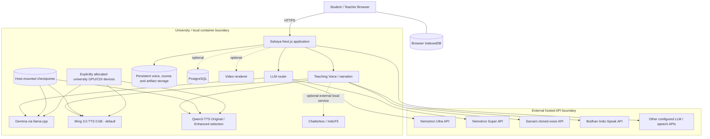

# Sahaya deployment architecture

## Verified LLM routing contract

- Primary default example: `openai:nvidia/nemotron-3-ultra-550b-a55b` at
  `https://integrate.api.nvidia.com/v1`.
- Optional secondary: `openai:nvidia/nemotron-3-super-120b-a12b`.
- Final fallback is mandatory when the router is enabled.
- Order is primary, optional secondary, then fallback. Retryable pre-commit failures can advance;
  committed streams do not silently switch models.
- Primary/secondary have process-local circuit breakers. The final fallback has no breaker.
- Role timeouts, initial stream timeout, total deadline, failure threshold, and cooldown use the
  existing `LLM_ROUTER_*` variables.
- `*_LOCAL=true` is an operator trust/routing declaration, not automatic endpoint discovery.

## Voice provider deployment status

| Provider | Current role | Container status |
| --- | --- | --- |
| Ming 3.0 TTS 0.5B | Default new English Teaching Voice; acoustic or embedding-only conditioning | Docker profile and native Podman GPU mode; target GPU validation still required |
| Qwen3-TTS 1.7B | Explicit Original or Enhanced cloned narration | Qwen service container supported; Enhanced still needs the separate in-app Resemble runtime |
| Chatterbox V3 | Optional cloned voice | Existing separate Python service; not clean-room container-validated here |
| IndicF5 | Optional Indian-language clone | Existing separate service; its documented CUDA environment is not clean-room validated |
| Sarvam | Hosted cloned voice using saved references or existing remote clone IDs | Server API adapter; no local model container |
| Bodhan Indic-Speak | Hosted preset synthesis | Server API adapter; no local model container |
| Kokoro | Standard TTS through the configured Lemonade-compatible endpoint | Not a bundled Sahaya model container |

No provider is silently substituted when a selected Teaching Voice engine is unavailable. Existing
course-specific selections and previously generated audio remain the course source of truth.

## Persistence

The application container stores server-owned state beneath `/app/data`. Docker uses a named volume;
the native Podman launcher uses `SAHAYA_DATA_DIR/app`. Model checkpoints are read-only mounts, while
cache and data paths persist across image rebuilds. PostgreSQL and browser IndexedDB are separate
stores; one does not automatically replace or synchronize the other.
