# Manim visualizations in Sahaya

A **Visualization** is a rendered animation that explains a change, process, or relationship. Use a **Slide** for static explanation and a **Simulation** when faculty need to change parameters and observe the result interactively. Outline generation offers Visualization when the renderer is healthy and an animated sequence serves the learning objective. Faculty can choose it manually, edit its title and instructions, set the depth, and select Automatic, Mathematical, Conceptual, Technical, Spatial / 3D, or Custom style.

In classroom playback, the player provides seeking, captions, replay, speed, fullscreen, and an animation download. The normal classroom controls can play and pause it. Leaving the scene pauses its audio and saves video position for the browser session.

## Architecture

```mermaid
flowchart LR
  Faculty --> Outline["Sahaya outline and editor"]
  Outline --> Director["Existing LLM router and visualization prompt"]
  Director --> Job["Owner-scoped scene attempt and status"]
  Job --> Renderer["Private Manim CPU queue"]
  Renderer --> Plan["Validate plan, references, math and limits"]
  Plan --> Cairo["Trusted Cairo compositor and FFmpeg"]
  Cairo --> Store["Owner-scoped MP4, poster, plan and metadata"]
  Director --> Voice["Existing Teaching Voice synthesis and audio pool"]
  Voice --> Timing["Measure audio and extend beats when needed"]
  Timing --> Job
  Store --> Classroom["Sahaya classroom player"]
  Voice --> Classroom
```



The app adds Visualization to the shared scene contract, outline stream, and scene editor. Generation uses the same scene attempts, action creation, course document persistence, and Teaching Voice scheduling as the other scene types. The renderer receives version 1 data, composes reusable Manim objects, and publishes a silent H.264/yuv420p MP4 with a JPEG poster. JSON course documents store an artifact reference, cue boundaries, and speech actions. The native Simulation iframe pipeline and configured AI and voice routing continue to serve their existing scene types.

The director can combine text, constrained TeX equations, dots, lines, arrows, shapes, 2D axes and planes, function and parametric curves, sampled data, sorting arrays, 3D axes, spheres, surfaces, and model-derived numerical labels. Beats sequence sets of parallel animations. The supported operations include drawing, writing, fades, replacement, movement, rotation, scaling, indication, following a path, and camera transitions. [Manim Community documentation](https://docs.manim.community/en/stable/) · [Community examples](https://www.manim.community/awesome/)

| Model | What it computes |
| --- | --- |
| Derivative | Numerical derivative, tangent line, and tangent point. The selected point must be in a stable local domain. |
| Projectile | Launch-to-landing trajectory on level ground, using SI units, constant gravity, and zero drag. |
| Interference | Pointwise sum of unit-amplitude sine waves. Phase is expressed in radians. |
| Gradient descent | Iterates for a one-variable loss and an optional surface with an added perpendicular squared term. |
| Insertion sort | Array states after each outer insertion. Equal values retain their relative order. |

Plans with a model display **Uses verified calculations** in the editor. Faculty should review the generated labels, explanation, and choice of model. Expressions have an allowlisted parser, bounded arithmetic, and domain checks. Claims expressed in arbitrary prose or general diagrams are illustrative. The supported JSON fields and limits are defined in [plan-v1.json](../services/manim-renderer/plan-v1.json).

## Editing and Teaching Voice

Open the Visualization scene in Pro mode. Change its settings or scientific parameters, render a preview, and apply the preview at final quality. You can also regenerate directly or replace the scene type in place. The existing narration timeline supports editing spoken text and regenerating speech with the selected Teaching Voice. A failed or cancelled update leaves the prior successful scene version available.

Sahaya synthesizes speech through the existing provider, measures the resulting audio, and reuses the saved plan when a longer clip requires extending a beat. The renderer uses emitted frame boundaries for the final cues. The player can also adapt pacing to updated or longer clips at playback time, which lets narration edits and voice switches reuse the animation. Timing changes never require passing voice samples or TTS credentials to Manim. Downloading the animation produces the silent MP4. Lecture video and subtitle export currently reports Visualization courses as unsupported.

## Jobs and storage

Scene content requests return a job ID. While a job is active it reports planning, validation, queue position, rendering, or artifact processing. The renderer validates data before queuing, uses a private working directory, and enforces a process deadline. Cancelling a running render terminates its process group. Renderer restarts invalidate active job IDs. Successful artifacts and identical-plan cache entries persist.

Artifacts are scoped to the authenticated faculty account. Next.js derives the owner namespace and checks the session on every media request, including byte ranges. A service token authenticates the private connection. An artifact is published only after the codec, dimensions, duration, poster, and hashes pass validation. The cache key includes the validated plan, renderer revision, output preset, and output limit. Changes to a plan or timing create a new artifact. Course ZIPs can reference these artifacts for the originating account. The visualization video lives in the renderer volume.

Protect and back up the artifact volume alongside Sahaya course and voice data. The service removes abandoned working directories at startup and expires inactive job records from memory. Completed versions are retained until the operator clears unreferenced versions after checking course references. At the configured quota, new renders fail with a storage error. Run one renderer per artifact volume.

## Local development

Use a disposable test profile and the existing Sahaya provider configuration. Establish a shared token and start the CPU renderer:

```bash
docker build -t sahaya-manim:local services/manim-renderer
export MANIM_RENDERER_TOKEN="$(openssl rand -hex 32)"
export OPENMAIC_ENABLE_MANIM=true
export MANIM_RENDERER_URL=http://127.0.0.1:8780

docker run --rm --name sahaya-manim-dev \
  --publish 127.0.0.1:8780:8780 \
  --env MANIM_RENDERER_TOKEN --env HOME=/tmp --env XDG_CACHE_HOME=/tmp \
  --volume sahaya-manim-dev:/artifacts \
  --read-only --tmpfs /tmp:size=512m,mode=1777 \
  --cap-drop ALL --security-opt no-new-privileges \
  --cpus 2 --memory 2g --pids-limit 128 \
  sahaya-manim:local
```

Run `pnpm dev` with the same three environment values in a second terminal. Sign in as a faculty member, choose a Teaching Voice, and request a course on tangent slopes or projectile motion. In the outline editor, choose **Visualization** for one item and keep a slide and a simulation in the course to exercise navigation. Generate, play, seek, move to another scene, return, then edit and regenerate the visualization in Pro mode. Enable `NEXT_PUBLIC_MAIC_EDITOR_ENABLED=true` if the Pro toggle is unavailable in the local build.

Run deterministic service checks and generate the demonstration videos without an LLM or TTS provider:

```bash
docker run --rm --network none --env MANIM_REAL_TESTS=1 sahaya-manim:local \
  python -m unittest -v test_plan test_service

docker run --name sahaya-manim-demo --network none --cpus 2 --memory 2g \
  sahaya-manim:local python demos.py /artifacts/demo
mkdir -p data/manim-demos
docker cp sahaya-manim-demo:/artifacts/demo/. data/manim-demos/
docker rm sahaya-manim-demo
```

## Container deployment

On an authorized test deployment, add `OPENMAIC_ENABLE_MANIM=true` and a private `MANIM_RENDERER_TOKEN` to the environment file. Set the same token for the app and the renderer. Compose needs the values in `.env` or its `--env-file` input for interpolation.

| Runtime | Commands |
| --- | --- |
| Docker | `scripts/deployment-preflight.sh --runtime docker --env-file .env` followed by `docker compose --profile manim up -d --build` and `docker compose --profile manim ps`. |
| Rootless Podman | `deploy/podman/sahaya-podman --mode basic --env-file .env preflight`, `build`, then `start` with the same options. Use the same mode and data directory across commands. Use `status` to verify health. |
| Rootless Quadlet | Build with the native manager. Run `deploy/podman/sahaya-podman --mode basic --env-file .env quadlet-install` in a test environment managed by rootless systemd, then check `systemctl --user status sahaya-manim.service`. |

For later HPC validation, use the deployment's authorized Sahaya mode in place of `basic`, keep its configured model and voice profiles, and provision the Manim artifact directory on persistent storage. Validate one preview and one standard render, playback using a test Teaching Voice profile, cancellation, and a failed regeneration with the old artifact preserved. Keep the private renderer port unpublished. The renderer uses CPU and requires no CDI device entry.

Configuration is listed in [.env.example](../.env.example). The defaults are one render worker, eight queued/running jobs, 2 CPU cores, 2 GiB memory, 512 MiB scratch space, 128 processes, a 120-second worker deadline, and a 90-second plan cap. Preview is 854×480 at 15 FPS, standard is 1280×720 at 30 FPS, and high is 1920×1080 at 30 FPS. The visualization pipeline caps each background request at 270 seconds including planning and queueing.

If Visualization is unavailable, check the feature flag, matching token, and service health. For render failures, review the reported plan error, simplify the scene or reduce its quality, and inspect the renderer logs. The pinned image supplies Manim, Cairo, TeX, Noto fonts and FFmpeg. The service runs as a non-root user with a read-only root filesystem and private scratch space. [Official Manim container documentation](https://docs.manim.community/en/stable/installation/docker.html) · [Manim source and releases](https://github.com/ManimCommunity/manim)

## Render validation

The following measurements are from real local Cairo renders on Docker Desktop-compatible Colima, using an ARM64 VM with a 2-core CPU limit and a 2 GiB memory limit. Wall time covers renderer process startup through artifact validation. No provider calls were made. The renderer records validation, scientific computation, queue, Cairo, encoding, and artifact timings. Sahaya logs planning and Teaching Voice synthesis separately.

| Visualization | Clip length at preview | Preview wall time | Preview MP4 | Standard wall time |
| --- | ---: | ---: | ---: | ---: |
| Derivative and tangent | 4.67 s | 1.93 s | 21,218 B | 2.12 s |
| Projectile motion | 4.67 s | 1.69 s | 25,408 B | |
| Wave interference | 4.67 s | 1.62 s | 32,633 B | |
| Gradient descent, curve and iterates | 6.20 s | 1.83 s | 23,897 B | |
| Gradient descent, 3D surface | 5.33 s | 4.92 s | 109,369 B | 8.70 s |
| Gradient descent, numerical updates | 6.13 s | 1.97 s | 28,711 B | |
| Insertion sort | 5.40 s | 1.79 s | 33,573 B | |

Standard MP4s were 34,670 B for the derivative and 245,121 B for the surface. Maximum observed child memory for the two benchmark groups was approximately 252 MiB for preview and 397 MiB for standard. Render times depend on hardware, scene complexity, fonts, and camera movement.

Scientific checks cover known numerical results, invalid expressions, physical boundaries, and plan limits. The real service test renders an equation and function graph, verifies range requests and owner checks, decodes the MP4, and confirms cache persistence across a service restart. The benchmark fixtures also exercise 3D, sequential and parallel beats, replacements, and motion along a calculated path. All nine benchmark MP4s played and sought successfully in Chrome. Representative preview frames were inspected for geometry, labels, and transitions.

## HPC validation protocol 3

The second HPC run exposed three independent failure paths. Sahaya accepted only two values per axis range even though Manim accepts a third tick interval. A field-only kind patch left incompatible fields on the same object. The validator stopped at structural errors and could reveal equation and scientific issues only on later calls. The repair prompt already received exact field paths. App logs hid unsupported names. The live plan bodies were unavailable, so the specific equation and model inputs remain unknown.

The compiler normalizes fixed metadata, recognized aliases, two-dimensional coordinates, operation arguments, and equivalent display math. Axes preserve a bounded tick interval. Plot domains use two endpoints. The renderer collects independent schema, equation, expression, reference, and scientific issues before queuing valid plans. It reports up to 24 issues and identifies blocked checks. Whole-object kind repairs keep IDs and unaffected fields. Equation edits must retain mathematical tokens. Model parameters and executable expressions stay protected. Planning still has three calls, 150 seconds for planning and validation, and 270 seconds overall.

Track first-pass acceptance, normalization, repair counts, and end-to-end success using the app's `Visualization generation metrics` entries. `Visualization plan validation` includes stage, outline, attempt, request, selected model, timing, issue paths, phases, and repair progress. `Visualization rendered` includes renderer timings. Renderer stdout also records job timing. The classroom reuses the existing authenticated status API after reload in the same browser tab. The app process holds job identities. An expired job or app restart can require a new attempt. Unsaved Pro mode previews and edits stay local to their editor session.

Enable `MANIM_CAPTURE_REJECTED_PLANS=true` on the renderer for a diagnostic window. The private service stores at most eight captures per owner and 64 total, capped at 192 KiB each. They expire after 24 hours. App logs contain capture IDs, and authenticated `GET /diagnostics/<id>` returns a capture only with the matching `X-Manim-Owner` (SHA-256 of the authenticated user ID). Captures contain generated plans and validation results. Treat them as private course data. Provider credentials, documents, and Teaching Voice samples are outside the capture request.

### Standalone university deployment

**Rebuild the renderer.** From the HPC login shell, with the existing renderer and `openmaic-llm-test` tmux session running:

```bash
cd /home/danish/projects/OpenMAIC-llm-test
git fetch origin feat/manim-integration
git switch feat/manim-integration
git merge --ff-only origin/feat/manim-integration
bash scripts/update-manim-hpc.sh
```

The script builds the workspace and image before stopping the renderer. It reuses the `sahaya-manim-hpc` artifact volume, existing private token, loopback port 8780, two CPUs, and 2 GiB memory. It checks authenticated protocol-3 readiness before restarting Next.js in its existing tmux pane on port 3003. The prior renderer stays available as a stopped container. Export `MANIM_CAPTURE_REJECTED_PLANS=true` before calling the script when captures are needed.

Watch `docker logs -f sahaya-manim-hpc` and `tmux capture-pane -pt openmaic-llm-test -S -200`. On HPC, retry both diffraction scenes and reload while a render is active. Check the original outline order, active phase, MP4 and Teaching Voice playback, and previous-artifact retention if a regeneration fails. Compare the measured first-pass and end-to-end success rates using live provider activity.
