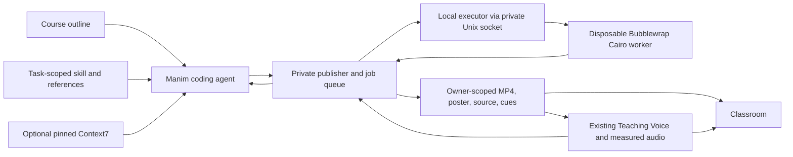

# Native Manim visualizations in Sahaya

Select **Visualization** in the existing outline editor to animate a mathematical, scientific, or conceptual process. The classroom player keeps its separate narration track, captions, seeking, playback speed, fullscreen, and video download. Pro mode supports preview, replacement, and individual regeneration. Applying a replacement publishes a checked video before switching the saved scene. Existing MP4s and posters remain readable from the original artifact volume, including courses created by the retired JSON compositor. Historical artifacts retain their original cues. New rendering of a historical scene generates native Python. Full lecture video export for visualization courses is still presented as unavailable.

## Architecture



The agent uses the existing scene-content model routing and activates only for Visualization generation and regeneration. It sends a restricted tool request through native function calling on the verified direct OpenAI transports. The routed Nemotron and Gemma transports use the equivalent validated JSON envelope. The envelope carries Python source and cue metadata. The source itself uses native Manim, with one predictable `GeneratedScene` entry point. The controller checks Python without importing it, starts a preview, relays bounded errors, rejects duplicate source and repeated errors, and decides whether to publish. The previous JSON animation schema, patcher, and compositor have been retired.

The builtin [Manim skill](../skills/sahaya-manim/SKILL.md) follows Agent Skills frontmatter. The runtime activates its main instructions, selects relevant local references, and loads additional references on a legitimate tool request or a render failure. This context is scoped to one execution. The source-first authoring pattern and topical reference organization draw on two MIT-licensed Manim skills. Sahaya authors its own instructions and execution adapter. [Agent Skills specification](https://agentskills.io/specification) · [Yusuke710/manim-skill](https://github.com/Yusuke710/manim-skill) · [ManimCE Best Practices](https://github.com/adithya-s-k/manim_skill/tree/main/skills/manimce-best-practices)

Context7 offers MCP, a CLI, and REST. Sahaya uses the REST context operation with library ID `/manimcommunity/manim/v0.22.1`. It sends fixed generic API topics and caches accepted snippets for 12 hours. A returned version mismatch, unavailable release, missing key, or network failure uses the local references. This keeps deployment independent of the indexed version. Exact version availability under the deployment’s Context7 credentials remains to be checked. The agent treats returned snippets as reference data. [Context7 Manim library](https://context7.com/manimcommunity/manim) · [Context7 REST version behavior](https://context7.com/docs/api-guide#use-specific-versions) · [Manim Community v0.22.1](https://docs.manim.community/en/stable/changelog/0.22.1-changelog.html)

## Execution and university prerequisites

The HPC publisher retains the existing artifact volume and connects to an unprivileged executor on the same host through an authenticated Unix socket. The publisher container mounts the private socket directory read-only. Neither the app nor the executor requires the Docker socket. Bubblewrap constructs a fresh mount namespace from a reviewed, read-only Manim runtime filesystem exported from the pinned worker image. Generated Python does not receive either service's socket, the repository, home directories, credentials or the artifact volume. Sources and bounded MP4 output move through pipes. The publisher independently decodes and validates the media before committing it.

### Runtime security requirements

The supplied Ubuntu 20.04 build `0.4.0-1ubuntu4.1` is ineligible. Upstream fixed CVE-2026-87766 in 0.12.0. Ubuntu's USN-8779-2 reverted its initial fix, including the Focal ESM update. The successful `env -i` tests on 0.4.0 establish basic namespace functionality. The executor requires an administrator-reviewed, non-set-ID Bubblewrap 0.12.0 or newer with an exact approved binary digest. It launches with an empty host environment and also uses the supported `--clearenv` flag. Build and verify patched binaries in a user-local staging directory against Focal's ABI. An administrator then copies the reviewed build into a protected path. This path needs no changes to the system package or Docker daemon. [Upstream advisory](https://github.com/containers/bubblewrap/security/advisories/GHSA-pxhw-h44j-8pfx) · [Ubuntu regression notice](https://ubuntu.com/security/notices/USN-8779-2) · [Bubblewrap security model](https://github.com/containers/bubblewrap/blob/main/SECURITY.md)

The dedicated account needs Linux Python 3.10+ with pidfd support, an approved libseccomp 2.6.2 or newer, and FFmpeg/ffprobe for the trusted startup fixture. These tools can be provisioned alongside the executor in an administrator-reviewed directory. Manim, Cairo, TeX and fonts come from the extracted image. User namespaces must be available to the service account on the actual kernel. Bubblewrap shares the host kernel. The university must review that exposure, the seccomp policy, and the account's cgroup and filesystem access. [libseccomp security releases](https://github.com/seccomp/libseccomp/releases) · [Bubblewrap isolation options](https://github.com/containers/bubblewrap/blob/main/bwrap.xml)

The executor supports **one** active local worker. It starts a trusted launcher behind a pipe gate, verifies its migration into dedicated CPU, memory and PID cgroup v1 leaves, then releases it to Bubblewrap. The administrator provisions those leaves and delegates only writes to their `cgroup.procs` files to the executor account. The administrator owns the leaves and limit files. Use canonical paths on the real kernel controller mounts and keep the leaves empty of other services or descendants. Example caps are `cpu.cfs_period_us=100000`, `cpu.cfs_quota_us=200000`, `memory.limit_in_bytes=2147483648`, `memory.memsw.limit_in_bytes=2147483648`, and `pids.max=128`. The memory+swap controller must be present and enforced. When the host lacks delegation or a required controller, generation stays disabled. [Linux CPU bandwidth](https://docs.kernel.org/scheduler/sched-bwc.html) · [Linux cgroup v1 memory controller](https://docs.kernel.org/admin-guide/cgroup-v1/memory.html) · [Linux PID controller](https://docs.kernel.org/admin-guide/cgroup-v1/pids.html)

The worker gets isolated user, PID, IPC, UTS, mount, network and cgroup namespaces. It has a 512 MiB private tmpfs, a read-only runtime and proc mount, and four standard character devices for null, zero and randomness. It runs as namespace UID/GID 1000 with no effective capabilities. Bubblewrap disallows nested user namespaces, and a seccomp filter blocks namespace syscalls, new-namespace clone flags, sockets and sensitive kernel interfaces. Python and TeX run inside this environment, with TeX shell escape disabled. Deadlines, cancellation and pipe limits terminate work and drain the job's dedicated cgroups using pidfds. Failed cleanup blocks further launches.

### Provision and verify on the university host

Build and export a trusted Manim runtime using the approved branch source. The image is a staging artifact and does not run generated Python under ordinary Docker.

```bash
docker build -f services/manim-renderer/Dockerfile.sandbox -t sahaya-manim-worker:0.22.1 services/manim-renderer
docker image inspect --format '{{.Id}}' sahaya-manim-worker:0.22.1
worker=$(docker create sahaya-manim-worker:0.22.1)
docker export "$worker" > sahaya-manim-worker-rootfs.tar
docker rm "$worker"
sha256sum sahaya-manim-worker-rootfs.tar
```

The administrator extracts this verified archive into a new protected root-owned directory such as `/opt/sahaya-manim/rootfs-0.22.1`. Normalize ownership recursively without following symlinks, remove group/other write and set-ID bits from files and directories, and keep `dev`, `proc`, and `tmp` present and empty. The runtime tree permits regular files, directories, and internal symlink paths resolved by the sandbox. It must contain no mounted subtrees, special files, app configuration or host credentials. Publish and treat the tree as immutable.

Separately provision `/run/sahaya-manim` mode 0750, owned by the executor account with a dedicated non-root group. Use that group as the executor's primary group or set the directory's setgid bit (mode 2750). The directory contains only the socket and its lock file. Give the deployment operator access through the dedicated group. The update script maps that group into the publisher, whose UID stays 1000. Keep the directory in place across executor restarts so the publisher sees the replacement socket.

The administrator maintains a protected policy at `/etc/sahaya-manim/bubblewrap.json`. Populate it with the observed image ID, SHA-256 of the final Bubblewrap executable, and actual canonical controller paths.

```json
{
  "approved": false,
  "binary": "/opt/sahaya-manim/bin/bwrap",
  "binary_sha256": "<64 hex digits>",
  "libseccomp": "/opt/sahaya-manim/lib/libseccomp.so.2.6.2",
  "rootfs": "/opt/sahaya-manim/rootfs-0.22.1",
  "image": "sha256:<worker image ID>",
  "cgroups": {
    "cpu": "/sys/fs/cgroup/cpu,cpuacct/sahaya-manim",
    "memory": "/sys/fs/cgroup/memory/sahaya-manim",
    "pids": "/sys/fs/cgroup/pids/sahaya-manim"
  }
}
```

Run verification as the executor account on the host with the executor stopped and the reviewed release files available:

```bash
/usr/bin/bwrap --version
dpkg-query -W bubblewrap
bash scripts/verify-manim-bubblewrap.sh /etc/sahaya-manim/bubblewrap.json /run/sahaya-manim
```

The standalone verification uses synthetic canaries and a fixed Manim scene. It checks namespace and host process visibility, policy limits and group membership, socket and environment isolation, syscall restrictions, scratch capacity, timeouts, cancellation, descendant cleanup, and frame-derived output. These checks verify the configured controls within their scope. They do not constitute an administrator security review or a load test.

After accepting the residual kernel risk and the verification evidence, the administrator sets `approved` to `true` and starts the executor with its protected `MANIM_SANDBOX_TOKEN` environment variable as the designated account:

```bash
python3 services/manim-renderer/bubblewrap_broker.py serve /etc/sahaya-manim/bubblewrap.json /run/sahaya-manim
```

Use the reviewed release's service code and trusted service environment. The executor repeats technical verification before serving. The publisher's authenticated `/ready` reports protocol 4 with backend `bubblewrap` and `isolation: verified`. Its `/health` remains liveness only. A local socket failure cannot switch the publisher to an HTTPS transport. The previous gVisor broker remains optional on deployments explicitly configured for HTTPS. [gVisor Docker runtime documentation](https://gvisor.dev/docs/user_guide/quick_start/docker/)

Artifact storage keeps Python source, timing, render metadata and media distinct. Cache keys include the canonical request, immutable worker image, publisher revision and limits, under an owner directory. Temporary editor previews expire after two hours. Unpublished checks and failed attempts are cleaned up. Durable course media is preserved. The storage quota blocks further publication until an administrator can review stored usage and course references.

## Teaching Voice

Sahaya adopts the duration-tracker approach of Manim Voiceover. The plugin itself is not a runtime dependency. Its v0.3.7 package metadata broadly accepts Manim versions, so that metadata alone does not establish compatibility with the pinned Cairo renderer. Keeping voice synthesis in Sahaya also permits offline renders and the current Teaching Voice providers. [Manim Voiceover v0.3.7](https://voiceover.manim.community/en/stable/) · [Plugin package metadata](https://github.com/ManimCommunity/manim-voiceover/blob/v0.3.7/pyproject.toml) · [Manim v0.22.1 Cairo implementation](https://github.com/ManimCommunity/manim/blob/v0.22.1/manim/renderer/cairo_renderer.py)

Generated scenes call `with self.cue("id"):` around native animations. The adapter tracks emitted frames and pads short cues against measured narration. On the classroom paths with a server voice, a playable preview can appear while the trusted app synthesizes the audio. The app then promotes the source to a final silent render using measured durations, without a model call. When recorded audio fits an existing final render, the player can reuse it. When synthesis or exact retiming fails, playable media and adaptive pacing remain available. Faculty can use preview and regeneration in Pro mode to render again with the currently selected voice. The headless content path can publish a silent final without a browser narration pass.

New native results are labeled illustrative. Skill guidance calls for formula, unit, axis and boundary checks, and the regression suite independently verifies numerical relationships for diffraction and the retained numerical helpers. A successful render is a media result. Faculty review remains necessary for the generated scientific and visual claims.

## Configuration and rollout

The app uses `OPENMAIC_ENABLE_MANIM`, `MANIM_RENDERER_URL`, `MANIM_RENDERER_TOKEN`, and optionally `CONTEXT7_API_KEY`. Defaults are four active agents per app process, three model turns, two Context7 lookups, three previews, two final attempts, and 260 seconds per agent execution. The controller bundles relevant local references up front. The first turn can request one batch of missing topics when at least two Python submission turns will remain. Later turns accept only Python and cue metadata. Routed deployments use plain Chat Completions text and validate the JSON transport locally, including on Gemma. Later turns continue from the last successful routing tier. See [environment examples](../.env.example). The HPC publisher uses `MANIM_SANDBOX_SOCKET` and `MANIM_SANDBOX_TOKEN`. Its queue defaults to one worker and eight active jobs. The executor defaults to a 45-second preview and 105-second final attempt, configurable with `MANIM_SANDBOX_PREVIEW_SECONDS` and `MANIM_SANDBOX_FINAL_SECONDS`. The optional gVisor backend uses `MANIM_SANDBOX_URL`.

Docker Compose retains the `manim` profile and persistent volume. Podman and Quadlet use the same publisher image and artifact mount. The existing HTTPS deployment works with approved gVisor. A Compose local deployment adds a publisher-only read-only bind of the socket directory plus the mapped socket group, and sets `MANIM_SANDBOX_SOCKET` to the in-container path. Verify group and UID mapping before using a local socket with rootless container engines.

On the university HPC server, the standalone update script stages the new publisher image before stopping the Next.js pane. It verifies the local socket before changing services, stops Next.js before rebuilding the workspace, verifies actual HTTP readiness, and preserves the previous renderer container for rollback. The original renderer token, port, resource limits, and `sahaya-manim-hpc:/artifacts` persist. Gemma and Teaching Voice services remain on their existing allocations. If Next.js cannot restart after an upgrade, rollback restores the old renderer and attempts to restart the prior app revision from a separate worktree. That app recovery uses the local pnpm store and the original environment. [Standalone update script](../scripts/update-manim-hpc.sh)

```bash
(
  set -euo pipefail
  cd /home/danish/projects/OpenMAIC-llm-test
  git fetch origin refs/heads/feat/manim-integration
  git show FETCH_HEAD:scripts/update-manim-hpc.sh | bash -s -- FETCH_HEAD
)
```

Export the protected `MANIM_SANDBOX_TOKEN` for the first Bubblewrap rollout. `MANIM_BWRAP_SOCKET_DIR` defaults to `/run/sahaya-manim`. The rollout rebuilds the publisher and verifies that UID 1000 can execute its healthcheck. Leave the current deployment running while the university provisions the executor.

## Live verification and troubleshooting

1. Verify authenticated publisher readiness shows `secureExecution: true`, `isolation: verified`, and protocol 4. With broker availability intentionally removed in an approved test window, check that historical playback remains available and the app declines fresh generation before provider use.
2. Generate or retry the existing single-slit intensity and grating scenes. Verify both formulas, central peak and minima, labels, spacing and animations. Test another topic that uses native geometry or 3D.
3. Refresh while rendering and confirm the classroom rejoins the current job and keeps its outline order. Attempt a failed regeneration and confirm the previous video remains playable.
4. Check cue transitions, seeking, captions, playback speed and voice switching with real Teaching Voice audio. Measure first-pass preview success and final acceptance on the actual Linux host.

Monitor the publisher with `docker logs -f sahaya-manim-hpc`, the app with `tmux capture-pane -pt openmaic-llm-test -S -200`, and the sandbox broker’s approved service logs. App events include `Manim skill activated`, `Manim documentation read`, `Manim tool request`, `Manim render evaluated`, `Manim agent completed` and existing `SceneNarration` timing events. Publisher events include `manim-artifact-checked` and `manim-render-failed`. Use model call, preview/final, token, CPU, memory and elapsed-time fields when available.

Enable `MANIM_CAPTURE_REJECTED_PLANS=true` on the publisher only for a bounded diagnostic window. It stores rejected Python and the sanitized issue for at most 24 hours. Caps are eight captures per owner, 64 total. Authenticated internal `/diagnostics/<id>` requires the owning principal’s SHA-256 namespace. Generated source can contain course content and should be handled privately. Raw worker stdout and stderr stay outside logs and model feedback.
