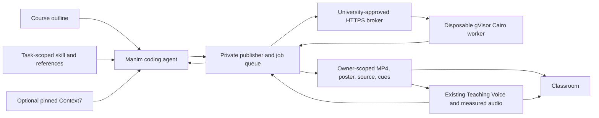

# Native Manim visualizations in Sahaya

Select **Visualization** in the existing outline editor to animate a mathematical, scientific, or conceptual process. The classroom player keeps its separate narration track, captions, seeking, playback speed, fullscreen, and video download. Pro mode supports preview, replacement, and individual regeneration. Applying a replacement publishes a checked video before switching the saved scene. Existing MP4s and posters remain readable from the original artifact volume, including courses created by the retired JSON compositor. Historical artifacts retain their original cues. New rendering of a historical scene generates native Python. Full lecture video export for visualization courses is still presented as unavailable.

## Architecture



The agent uses the existing scene-content model routing and activates only for Visualization generation and regeneration. It sends a restricted tool request through native function calling on the verified direct OpenAI transports. The routed Nemotron and Gemma transports use the equivalent validated JSON envelope. The envelope carries Python source and cue metadata. The source itself uses native Manim, with one predictable `GeneratedScene` entry point. The controller checks Python without importing it, starts a preview, relays bounded errors, rejects duplicate source and repeated errors, and decides whether to publish. The previous JSON animation schema, patcher, and compositor have been retired.

The builtin [Manim skill](../skills/sahaya-manim/SKILL.md) follows Agent Skills frontmatter. The runtime activates its main instructions, selects relevant local references, and loads additional references on a legitimate tool request or a render failure. This context is scoped to one execution. The source-first authoring pattern and topical reference organization draw on two MIT-licensed Manim skills. Sahaya authors its own instructions and execution adapter. [Agent Skills specification](https://agentskills.io/specification) · [Yusuke710/manim-skill](https://github.com/Yusuke710/manim-skill) · [ManimCE Best Practices](https://github.com/adithya-s-k/manim_skill/tree/main/skills/manimce-best-practices)

Context7 offers MCP, a CLI, and REST. Sahaya uses the REST context operation with library ID `/manimcommunity/manim/v0.22.1`. It sends fixed generic API topics and caches accepted snippets for 12 hours. A returned version mismatch, unavailable release, missing key, or network failure uses the local references. This keeps deployment independent of the indexed version. Exact version availability under the deployment’s Context7 credentials remains to be checked. The agent treats returned snippets as reference data. [Context7 Manim library](https://context7.com/manimcommunity/manim) · [Context7 REST version behavior](https://context7.com/docs/api-guide#use-specific-versions) · [Manim Community v0.22.1](https://docs.manim.community/en/stable/changelog/0.22.1-changelog.html)

## Execution and university prerequisites

The trusted publisher has the artifact volume and communicates only with the configured HTTPS broker. The reference broker runs under university administrator control on a dedicated Linux execution host. It checks a registered `runsc` runtime, cgroup limits, its pinned worker image, per-container isolation settings, and an active benign probe. Trusted Docker CLI operations run only on the broker host. Sahaya’s app and publisher have no daemon socket. A failed, stale, incompatible, or absent broker capability disables generation before a model call. Publisher `/health` reports liveness. Authenticated `/ready` reports protocol 4 and the isolation status. The app capability also applies the feature flag. The broker protocol is 1. [gVisor Docker runtime documentation](https://gvisor.dev/docs/user_guide/quick_start/docker/)

University administrators provision an up-to-date gVisor `runsc` registered on a dedicated Docker daemon, working CPU quota, memory and swap accounting, PID limits, and an approved private TLS reverse proxy. The proxy should permit the publisher and HPC operator IPs, cap request bodies at 128 KiB, and allow at least 135 seconds for an execution request. Use a CA trusted by the publisher image. Set the broker token through a protected service environment file. The broker binds loopback port 8790 by default. The backend requires a current security review on the actual placement and runtime.

The administrator builds the worker from a trusted checkout on the execution host. Deploy the checked-out broker source as a managed service with the same revision.

```bash
docker build -f services/manim-renderer/Dockerfile.sandbox -t sahaya-manim-worker:0.22.1 services/manim-renderer
export MANIM_SANDBOX_IMAGE="$(docker image inspect --format '{{.Id}}' sahaya-manim-worker:0.22.1)"
export MANIM_SANDBOX_APPROVED=true
# MANIM_SANDBOX_TOKEN comes from the protected environment.
python3 services/manim-renderer/sandbox_broker.py
```

Each worker uses `--runtime=runsc`, no network, UID 1000, a read-only image, no added capabilities or devices, separate IPC, and no privilege escalation. Limits are two CPU cores, 2 GiB memory including swap allocation, 128 processes, and a 512 MiB private scratch filesystem. Python and TeX run only inside the disposable worker. TeX shell escape is disabled. Inputs and outputs travel through bounded pipes. The worker receives the source, cue IDs and numeric durations. It receives neither narration media nor service secrets. The trusted publisher verifies the silent H.264 stream, decoded frame counts, timing, file size, contrast samples, and a JPEG poster before atomic publication. The media check is automated and does not grade composition or scientific accuracy.

Artifact storage keeps Python source, timing, render metadata and media distinct. Cache keys include the canonical request, immutable worker image, publisher revision and limits, under an owner directory. Temporary editor previews expire after two hours. Unpublished checks and failed attempts are cleaned up. Durable course media is preserved. The storage quota blocks further publication until an administrator can review stored usage and course references.

## Teaching Voice

Sahaya adopts the duration-tracker approach of Manim Voiceover. The plugin itself is not a runtime dependency. Its v0.3.7 package metadata broadly accepts Manim versions, so that metadata alone does not establish compatibility with the pinned Cairo renderer. Keeping voice synthesis in Sahaya also permits offline renders and the current Teaching Voice providers. [Manim Voiceover v0.3.7](https://voiceover.manim.community/en/stable/) · [Plugin package metadata](https://github.com/ManimCommunity/manim-voiceover/blob/v0.3.7/pyproject.toml) · [Manim v0.22.1 Cairo implementation](https://github.com/ManimCommunity/manim/blob/v0.22.1/manim/renderer/cairo_renderer.py)

Generated scenes call `with self.cue("id"):` around native animations. The adapter tracks emitted frames and pads short cues against measured narration. On the classroom paths with a server voice, a playable preview can appear while the trusted app synthesizes the audio. The app then promotes the source to a final silent render using measured durations, without a model call. When recorded audio fits an existing final render, the player can reuse it. When synthesis or exact retiming fails, playable media and adaptive pacing remain available. Faculty can use preview and regeneration in Pro mode to render again with the currently selected voice. The headless content path can publish a silent final without a browser narration pass.

New native results are labeled illustrative. Skill guidance calls for formula, unit, axis and boundary checks, and the regression suite independently verifies numerical relationships for diffraction and the retained numerical helpers. A successful render is a media result. Faculty review remains necessary for the generated scientific and visual claims.

## Configuration and rollout

The app uses `OPENMAIC_ENABLE_MANIM`, `MANIM_RENDERER_URL`, `MANIM_RENDERER_TOKEN`, and optionally `CONTEXT7_API_KEY`. Defaults are four active agents per app process, three model requests, two documentation lookups, three previews, two final attempts, and 260 seconds per agent execution. See [environment examples](../.env.example). The publisher uses `MANIM_SANDBOX_URL` and `MANIM_SANDBOX_TOKEN` to reach the broker. The publisher queue defaults to one rendering worker and eight active jobs. The broker defaults to one execution slot, a 45-second preview, and a 105-second final attempt. It supports `MANIM_SANDBOX_CONCURRENCY`, `MANIM_SANDBOX_PREVIEW_SECONDS`, and `MANIM_SANDBOX_FINAL_SECONDS`, bounded by the deployment contract. Set publisher concurrency to match the approved broker capacity.

Docker Compose retains the `manim` profile and persistent volume. Use the existing deployment service build and profile commands to update it. Podman and Quadlet use the same publisher image, original artifact mount, and a separate publisher egress network; the approved gVisor broker remains external to all three launch paths. The deployment preflight checks configuration, and publisher readiness separately checks actual broker availability.

On the university HPC server, the standalone update script stages the new publisher image before stopping the Next.js pane. It checks the private broker before changing services, stops Next.js before rebuilding the workspace, verifies actual HTTP readiness, and preserves the previous renderer container for rollback. The original renderer token, port, resource limits, and `sahaya-manim-hpc:/artifacts` persist. Gemma and Teaching Voice services remain on their existing allocations. If Next.js cannot restart after an upgrade, rollback restores the old renderer and attempts to restart the prior app revision from a separate worktree. That app recovery uses the local pnpm store and the original environment. [Standalone update script](../scripts/update-manim-hpc.sh)

```bash
(
  set -euo pipefail
  cd /home/danish/projects/OpenMAIC-llm-test
  git fetch origin refs/heads/feat/manim-integration
  git show FETCH_HEAD:scripts/update-manim-hpc.sh | bash -s -- FETCH_HEAD
)
```

The upgrade expects exported `MANIM_SANDBOX_URL` and `MANIM_SANDBOX_TOKEN` on the first native rollout. The first broker build and publisher rebuild are required. Subsequent upgrades can recover broker settings already attached to the publisher. Leave the current deployment running while the university provisions the broker.

## Live verification and troubleshooting

1. Verify authenticated publisher readiness shows `secureExecution: true`, `isolation: verified`, and protocol 4. With broker availability intentionally removed in an approved test window, check that historical playback remains available and the app declines fresh generation before provider use.
2. Generate or retry the existing single-slit intensity and grating scenes. Verify both formulas, central peak and minima, labels, spacing and animations. Test another topic that uses native geometry or 3D.
3. Refresh while rendering and confirm the classroom rejoins the current job and keeps its outline order. Attempt a failed regeneration and confirm the previous video remains playable.
4. Check cue transitions, seeking, captions, playback speed and voice switching with real Teaching Voice audio. Measure first-pass preview success and final acceptance on the actual Linux host.

Monitor the publisher with `docker logs -f sahaya-manim-hpc`, the app with `tmux capture-pane -pt openmaic-llm-test -S -200`, and the sandbox broker’s approved service logs. App events include `Manim skill activated`, `Manim documentation read`, `Manim tool request`, `Manim render evaluated`, `Manim agent completed` and existing `SceneNarration` timing events. Publisher events include `manim-artifact-checked` and `manim-render-failed`. Use model call, preview/final, token, CPU, memory and elapsed-time fields when available.

Enable `MANIM_CAPTURE_REJECTED_PLANS=true` on the publisher only for a bounded diagnostic window. It stores rejected Python and the sanitized issue for at most 24 hours. Caps are eight captures per owner, 64 total. Authenticated internal `/diagnostics/<id>` requires the owning principal’s SHA-256 namespace. Generated source can contain course content and should be handled privately. Raw worker stdout and stderr stay outside logs and model feedback.
